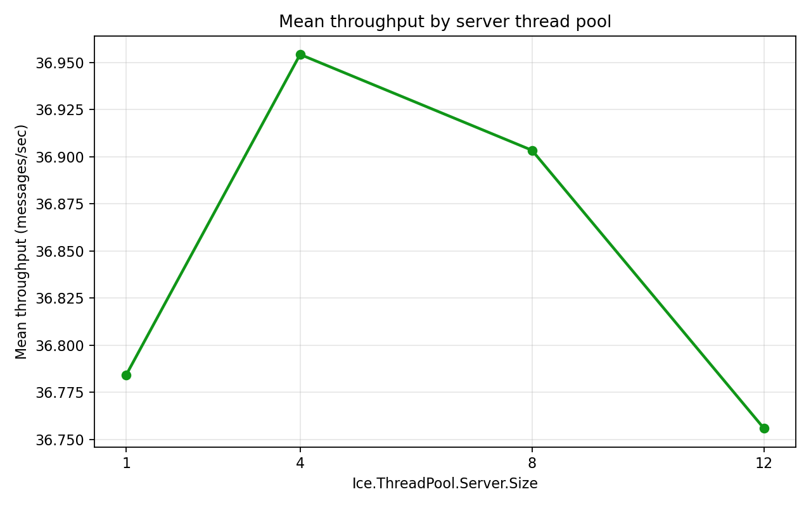

### Test executed

Build:

```bash
./scripts/build.sh
```

Result:

```text
BUILD SUCCESSFUL
```

Experiment:

```bash
XVFB_SCREEN=1280x720x24 ./scripts/run-experiments.sh
```

The script ran:

- 4 server configurations: thread pools `1`, `4`, `8`, `12`
- 3 runs per configuration
- 4 clients per run
- 600 images per client
- 2,400 images per run
- 100% `CRITICAL`
- Xvfb-backed X11 capture without Wayland screen-share prompts

Total:

```text
12 runs
48 client executions
28,800 images sent
28,800 images processed
```

### Verification

Every client log reported:

```text
messages=600
```

Every client sent:

```text
600 CRITICAL
0 NORMAL
```

Each client received `ACTION for BUSID` callbacks. The server logs each reported:

```text
Processed messages: 2400
```

No experiment log contained errors, exceptions, failures, or `NA` results.

The final run stored 2,400 images under:

```text
Group9/1/
Group9/2/
Group9/3/
Group9/4/
```

The filenames were in the expected format, for example:

```text
Group9/1/CRITICAL-2026-11-14-03-27-18-865.jpg
```

### Results summary

Results are saved in `experiments/results.csv`.

| Thread pool size | Run | Client | Average send latency (ms) | Throughput (msg/sec) |
|---:|---:|---:|---:|---:|
| 1 | 1 | 1 | 5.259 | 36.33 |
| 1 | 1 | 2 | 5.132 | 35.11 |
| 1 | 1 | 3 | 5.468 | 35.74 |
| 1 | 1 | 4 | 5.094 | 35.11 |
| 1 | 2 | 1 | 5.109 | 36.09 |
| 1 | 2 | 2 | 5.535 | 36.93 |
| 1 | 2 | 3 | 5.005 | 37.60 |
| 1 | 2 | 4 | 5.022 | 37.90 |
| 1 | 3 | 1 | 5.211 | 35.99 |
| 1 | 3 | 2 | 5.278 | 37.56 |
| 1 | 3 | 3 | 5.402 | 36.79 |
| 1 | 3 | 4 | 5.218 | 37.19 |
| 4 | 1 | 1 | 4.942 | 37.69 |
| 4 | 1 | 2 | 4.832 | 36.41 |
| 4 | 1 | 3 | 4.809 | 37.91 |
| 4 | 1 | 4 | 4.720 | 36.24 |
| 4 | 2 | 1 | 4.758 | 37.87 |
| 4 | 2 | 2 | 4.893 | 37.29 |
| 4 | 2 | 3 | 4.890 | 37.09 |
| 4 | 2 | 4 | 4.918 | 37.72 |
| 4 | 3 | 1 | 4.739 | 37.63 |
| 4 | 3 | 2 | 4.818 | 36.06 |
| 4 | 3 | 3 | 4.840 | 37.58 |
| 4 | 3 | 4 | 4.682 | 36.79 |
| 8 | 1 | 1 | 4.871 | 35.85 |
| 8 | 1 | 2 | 4.895 | 37.31 |
| 8 | 1 | 3 | 5.085 | 37.10 |
| 8 | 1 | 4 | 4.753 | 35.39 |
| 8 | 2 | 1 | 4.753 | 37.85 |
| 8 | 2 | 2 | 4.874 | 36.28 |
| 8 | 2 | 3 | 4.693 | 37.56 |
| 8 | 2 | 4 | 4.813 | 37.51 |
| 8 | 3 | 1 | 4.905 | 38.18 |
| 8 | 3 | 2 | 4.837 | 37.85 |
| 8 | 3 | 3 | 4.725 | 37.66 |
| 8 | 3 | 4 | 4.691 | 35.85 |
| 12 | 1 | 1 | 4.838 | 36.10 |
| 12 | 1 | 2 | 4.827 | 36.23 |
| 12 | 1 | 3 | 4.598 | 35.87 |
| 12 | 1 | 4 | 4.645 | 37.78 |
| 12 | 2 | 1 | 4.955 | 37.36 |
| 12 | 2 | 2 | 4.972 | 38.09 |
| 12 | 2 | 3 | 5.042 | 37.71 |
| 12 | 2 | 4 | 5.008 | 36.31 |
| 12 | 3 | 1 | 4.715 | 37.48 |
| 12 | 3 | 2 | 4.801 | 36.82 |
| 12 | 3 | 3 | 4.562 | 37.95 |
| 12 | 3 | 4 | 4.567 | 36.21 |

### Plots

#### Mean send latency


#### Mean throughput




Logs are stored in `experiments/`.

The server and clients exited cleanly after the experiment.
