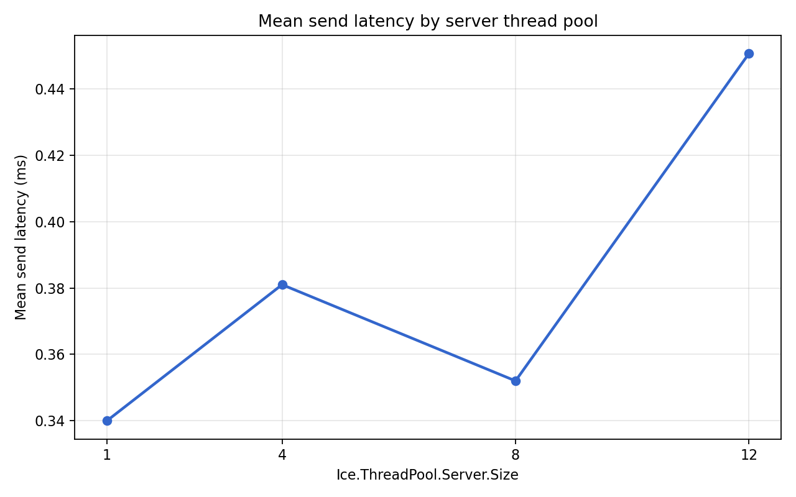

### Test executed

**Note:** This test was executed in a UTM Ubuntu for ARM virtual machine on a
macOS host. The guest exposes the following environment:

| |  |
|---|---|
| Host | macOS GoldenGate 27.0.1 |
| Virtualization | UTM QEMU |
| architecture | ARM64 |
| VM CPUs | 10 |
| VM memory | 3.3 GiB |
| Ubuntu | Ubuntu 26.04.1 LTS |


Build:

```bash
./scripts/build.sh
```

Result:

```text
BUILD SUCCESSFUL
```

Experiment:

```bash
XVFB_SCREEN=1280x720x24 ./scripts/run-experiments.sh
```

The script ran:

- 4 server configurations: thread pools `1`, `4`, `8`, `12`
- 3 runs per configuration
- 4 clients per run
- 600 images per client
- 2,400 images per run
- 100% `CRITICAL`
- Xvfb-backed X11 capture without Wayland screen-share prompts

Total:

```text
12 runs
48 client executions
28,800 images sent
28,800 images processed
```

### Verification

Every client log reported:

```text
messages=600
```

Every client sent:

```text
600 CRITICAL
0 NORMAL
```

Each client received `ACTION for BUSID` callbacks. The server logs each reported:

```text
Processed messages: 2400
```

No experiment log contained errors, exceptions, failures, or `NA` results.

The final run stored 2,400 images under:

```text
Group9/1/
Group9/2/
Group9/3/
Group9/4/
```

The filenames were in the expected format, for example:

```text
Group9/1/CRITICAL-2026-11-14-03-27-18-865.jpg
```

### Results summary

Results are saved in `experiments/results.csv`:

| Thread pool size | Run | Client | Average send latency (ms) | Throughput (msg/sec) |
|---:|---:|---:|---:|---:|
| 1 | 1 | 1 | 0.300 | 1704.16 |
| 1 | 1 | 2 | 0.247 | 1911.18 |
| 1 | 1 | 3 | 0.235 | 2085.18 |
| 1 | 1 | 4 | 0.437 | 1418.50 |
| 1 | 2 | 1 | 0.413 | 1349.84 |
| 1 | 2 | 2 | 0.471 | 1220.64 |
| 1 | 2 | 3 | 0.265 | 1942.72 |
| 1 | 2 | 4 | 0.321 | 1867.58 |
| 1 | 3 | 1 | 0.386 | 1522.69 |
| 1 | 3 | 2 | 0.243 | 2076.76 |
| 1 | 3 | 3 | 0.259 | 2144.59 |
| 1 | 3 | 4 | 0.503 | 1350.81 |
| 4 | 1 | 1 | 0.438 | 1498.93 |
| 4 | 1 | 2 | 0.437 | 1479.81 |
| 4 | 1 | 3 | 0.329 | 1636.02 |
| 4 | 1 | 4 | 0.392 | 1560.30 |
| 4 | 2 | 1 | 0.473 | 1419.24 |
| 4 | 2 | 2 | 0.460 | 1390.06 |
| 4 | 2 | 3 | 0.272 | 2013.59 |
| 4 | 2 | 4 | 0.263 | 2065.94 |
| 4 | 3 | 1 | 0.431 | 1321.54 |
| 4 | 3 | 2 | 0.395 | 1340.65 |
| 4 | 3 | 3 | 0.451 | 1335.31 |
| 4 | 3 | 4 | 0.231 | 2263.43 |
| 8 | 1 | 1 | 0.276 | 1975.35 |
| 8 | 1 | 2 | 0.364 | 1611.80 |
| 8 | 1 | 3 | 0.401 | 1537.94 |
| 8 | 1 | 4 | 0.432 | 1475.20 |
| 8 | 2 | 1 | 0.280 | 1962.84 |
| 8 | 2 | 2 | 0.291 | 1942.15 |
| 8 | 2 | 3 | 0.372 | 1684.53 |
| 8 | 2 | 4 | 0.407 | 1592.21 |
| 8 | 3 | 1 | 0.292 | 1974.61 |
| 8 | 3 | 2 | 0.393 | 1638.44 |
| 8 | 3 | 3 | 0.296 | 1920.71 |
| 8 | 3 | 4 | 0.420 | 1552.52 |
| 12 | 1 | 1 | 0.715 | 1010.45 |
| 12 | 1 | 2 | 0.667 | 1046.98 |
| 12 | 1 | 3 | 0.645 | 1032.85 |
| 12 | 1 | 4 | 0.761 | 949.44 |
| 12 | 2 | 1 | 0.241 | 2253.09 |
| 12 | 2 | 2 | 0.391 | 1616.11 |
| 12 | 2 | 3 | 0.447 | 1451.09 |
| 12 | 2 | 4 | 0.247 | 2196.12 |
| 12 | 3 | 1 | 0.399 | 1653.10 |
| 12 | 3 | 2 | 0.326 | 1802.79 |
| 12 | 3 | 3 | 0.312 | 1864.00 |
| 12 | 3 | 4 | 0.257 | 2070.97 |


### Plots

#### Mean send latency



#### Mean throughput


Logs are stored in `experiments/`.

The server and clients exited cleanly after the experiment.
